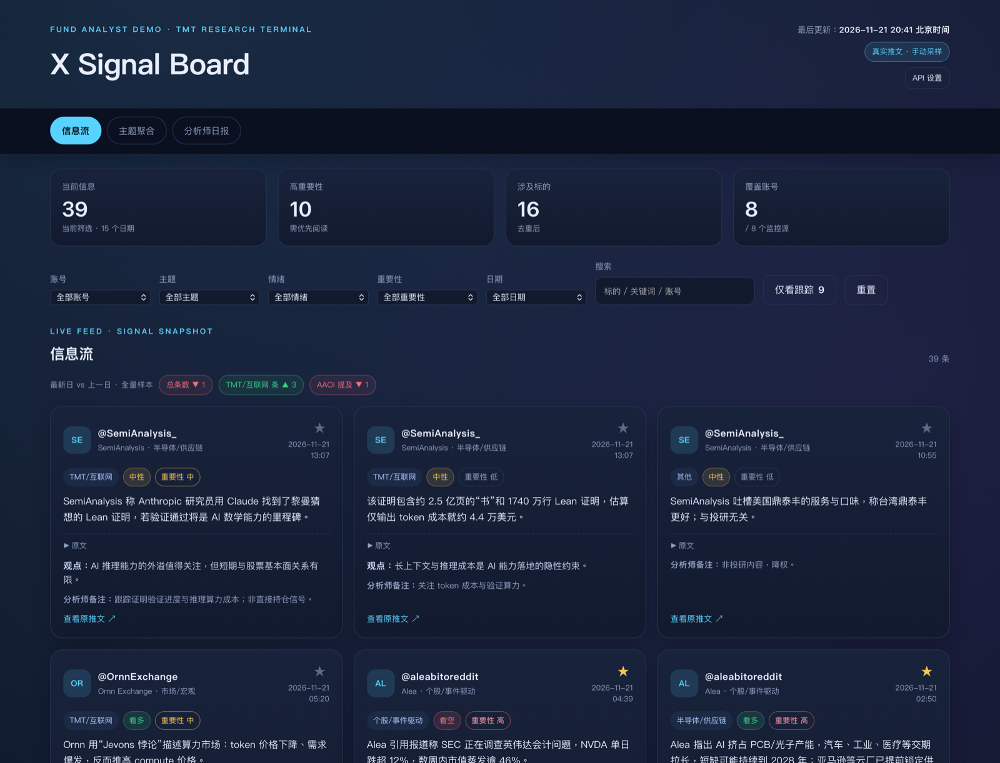

# X Signal Board · TMT Research Terminal

面向基金投研的 X（Twitter）信息聚合看板。默认加载 **39 条真实公开推文**，按主题、情绪、标的聚合，并生成按日分析师日报；支持 GitHub Actions 自动快照、本地 X API token 同步，以及 40 条合成样本演示。



> 当前默认数据源：`真实推文 · 手动采样`（非实时）。本项目不构成任何投资建议。

## 功能

- **信息流**：中文摘要、可展开英文原文、观点、标的、情绪、重要性、分析师备注、原推文链接。
- **筛选**：账号 / 主题 / 情绪 / 重要性 / 日期 / 关键词，支持「仅看跟踪」。
- **主题聚合**：主题卡、标的提及 Top 12、按有数据日期的多空情绪趋势。
- **分析师日报**：日期切换、核心观点、高频标的、情绪变化、重要变化、Top 5、待跟踪；可下载 Markdown、打印 PDF。
- **研究跟踪**：星标 + `localStorage`，跨日期保留。
- **数据源切换**：本地服务 token / Actions Secret / mock 三种模式，页面顶部有来源标识。

## 快速开始

**只看静态页面**：双击 `index.html`，无需安装、无需构建。

**用页面「API 设置」输入 token 并立即同步**：

```bash
python3 server/app.py --open
# 或双击 start.command；没有执行权限时 bash start.command
# Windows: start.bat
```

打开 `http://127.0.0.1:8787` → 右上角 **API 设置** → 粘贴 token → **测试连接** → **保存并同步**。

- token 只存本机服务内存，不写 localStorage / 文件 / 日志。
- 本地服务重启后 token 清空。
- 本地同步只改本机 `data.js` / `data/history.json`，**不会自动 push 到 GitHub**。
- 在 GitHub Pages 上打开时，设置里会显示「未连接本地服务」，输入框禁用。

**重新生成数据**：

```bash
python3 scripts/sync_x.py          # 默认优先 manual 真实样本
MOCK_SYNC=1 python3 scripts/sync_x.py   # 切回 40 条合成 mock
```

## 数据来源

| 模式 | 数据 | 页面标识 |
|---|---|---|
| `manual` | 39 条真实公开推文（fxtwitter 采样，含英文原文 + 中文标注） | 真实推文 · 手动采样 |
| `x-api` | X API v2 抓取（需要付费 token） | X API · 数据已同步 |
| `mock` | 40 条合成样本（`x_mock.json`） | 模拟自动更新 · 非实时 |

优先级：**x-api > manual > mock**。数据源切换时 `data/history.json` 会重置，不会把合成和真实数据混在一起。

- 当前真实样本：8 个账号、39 条、15 个日期（2025-04-08 ~ 2026-11-21）。
- 40 条链接中 1 条是纯媒体推文、没有文本，导入时被跳过。
- 真实样本含少量非投研/个人内容，已标为「其他」或低重要性；可用重要性筛选过滤。

## 后期接入真实 X API

### 方式 A：GitHub Actions 自动更新

1. 购买支持读取用户时间线的 X API 档位。
2. 在仓库 **Settings → Secrets and variables → Actions** 添加 `X_BEARER_TOKEN`。
3. 进入 **Actions → Check X API → Run workflow**，确认 token 可用；401/403/429 会显示原因。
4. 进入 **Actions → Sync X signals → Run workflow**，同步一次。
5. 脚本检测到 token 后自动切到 `x-api`，页面顶部变成 `X API · 数据已同步`。
6. `Sync X signals` 默认每天 07:00（北京时间）运行；有变化才 commit，Pages 自动重部署。

### 方式 B：本地服务即时同步

1. 启动 `python3 server/app.py --open`，打开 `http://127.0.0.1:8787`。
2. **API 设置** → 粘贴 token → 测试连接 → 保存并同步。
3. 想清除内存中的 token：点 **清除 token**。

### 注意

- 没有额度时同步会返回 403/429；脚本会保留上一版 `data.js` / `history.json`，不会白屏。
- `x-api` 模式目前是规则打标：摘要为英文原文截断，主题/标的/情绪/重要性自动生成，`viewpoint / note` 为空；中文摘要需要再接一条 LLM 流水线。
- token 不要写进代码、`data.js`、localStorage 或聊天；如果泄露，立刻在 X Developer Portal 轮换。

## 手动更新真实推文

1. 把新的推文链接加到 `data/links.txt`。
2. 运行 `python3 scripts/import_fxtwitter.py`。
3. 在 `data/fixtures/x_manual_notes.json` 补充中文摘要/观点（可选）。
4. 运行 `python3 scripts/sync_x.py` 生成 `data.js`。

`import_fxtwitter.py` 会复用已有中文标注，不会覆盖人工内容。fxtwitter 是第三方服务，可能限流/失效；正式商用请用 X 官方 API。

## 部署到 GitHub Pages

1. 新建仓库，例如 `x-signal-board`（public 才能免费用 Pages）。
2. 上传整个项目内容，包括 `data/`、`scripts/`、`server/`、`.github/`。
3. 如果网页上传看不到 `.github`：用 **Add file → Create new file** 分别创建 `.github/workflows/sync.yml` 和 `.github/workflows/check.yml`，粘贴本地内容。
4. **Settings → Pages**：Deploy from a branch → `main` / `/ (root)`。
5. 访问 `https://你的用户名.github.io/x-signal-board/`。
6. 要启用真实 API，再配置 `X_BEARER_TOKEN`；不配置时 Actions 会跑 manual 样本。

## 文件结构

```text
x-signal-board/
├── index.html / styles.css / app.js / api.js
├── data.js                     # 自动生成：页面读取的数据
├── data/
│   ├── links.txt               # 40 条原始推文链接
│   ├── accounts.json           # 8 个账号
│   ├── history.json            # 自动生成：主导数据
│   └── fixtures/
│       ├── x_manual.json       # 39 条真实推文
│       ├── x_manual_notes.json # 人工标注
│       └── x_mock.json         # 40 条合成 mock
├── scripts/
│   ├── import_fxtwitter.py     # 真实推文采集
│   ├── check_x_api.py          # token/额度预检
│   └── sync_x.py               # x-api / manual / mock → data.js
├── server/app.py               # 本地服务 + token/check/sync API
├── start.command / start.bat
├── .github/workflows/          # Check X API / Sync X signals
└── README.md / preview.png
```

## 局限性

- **manual 不是实时数据**：它是 39 条真实推文的手动快照，不会自动出现新推文；Actions 在没有 token 时只会重新生成并更新时间戳。
- **fxtwitter 是第三方接口**，可能限流、失效或停止服务；长期/商用请用 X 官方 API。
- **x-api 模式没有中文观点**：摘要是英文截断，主题/情绪是规则判断；需要额外 LLM 才能生成中文摘要与分析师观点。
- **本地 token 输入只适用于本机**：GitHub Pages 是静态托管，无法直连 X API；任何访客在 Pages 上输入 token 也不能工作。
- 没有登录、付费墙、数据库、多用户隔离或公网后端。
- GitHub Actions 的 cron 会延迟，不是分钟级实时。
- 公开仓库的数据也是公开的；真实推文展示需遵守 X 的条款。
- 前端一次性渲染当前样本；历史数据很长时需要分页。
- 已在 Safari 验证；Chrome 理论兼容但未实测。`file://` 下 localStorage 可能受限。

## 免责声明

本项目为投研信息聚合 Demo，不构成任何投资建议。  
X 内容版权归原作者所有；采集和使用时请遵守平台服务条款与相关合规要求。
